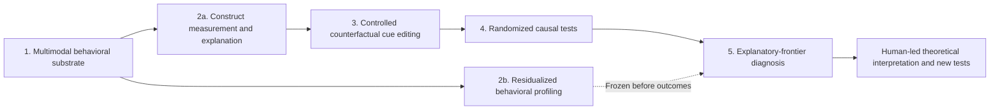

# Explanatory Frontier AI Toolkit

**Making the Explanatory Frontier of Upper-Echelons Theory Observable: An AI-Enabled Architecture for Measurement, Causal Discovery, and Theory Expansion**

> **Development-stage research artifact (Stage 1).
> This repository documents a proposed scientific workflow and its first prototype
> the measurement step for CEO trustworthiness,
> together with the protocol machinery that fixes every analytic choice before it is used.
> Modules are at different stages, and each is labelled below.
> Note: A design description is **not** evidence that a module has been implemented or validated.

How to read the status labels used in this repository:

| Label | Meaning |
|---|---|
| **Verified here** | Checked by tests or a run included in this repository (on synthetic or simulated data) |
| **Provided, not yet run here** | Code is included but has not been executed in this repository's test setup |
| **Reported, not reproducible here** | A result stated in the appendix whose data are not in this repository |
| **Planned** | Designed; no code in this release |

## 1. The scientific question

Executive theories rely on latent constructs, such as perceived trustworthiness, charisma, confidence
and authenticity, that are hard to observe repeatedly in natural settings. Video, audio and transcripts
of executives give rich behavioral traces, but a prediction score alone cannot show what a construct
captures, whether its apparent behavioral cues are causally consequential, or what systematic structure
lies beyond its measured scope.

The **explanatory frontier** is the empirically inspectable boundary of a construct's current behavioral
and causal explanatory reach. The workflow asks:

1. What information in natural behavior supports a construct's measurement?
2. Which candidate behavioral cues withstand randomized intervention?
3. Where are those causal effects stronger, weaker, or absent?
4. What reproducible, outcome-relevant behavioral structure remains outside the focal *measure* and calls
   for further theoretical scrutiny?

Residual structure is **not**, on its own, evidence of a new construct or theory. Interpretation,
validation and theory development remain researcher-led.

## 2. Architecture



**Confirmatory thread:** theory-defined construct ratings, multimodal measurement, candidate cue
selection, manipulation checks, randomized assessment of perceived trustworthiness.

**Residual-diagnostic thread:** construct-agnostic behavioral representation, out-of-sample
residualization, leakage checks, stable residual configurations, **freeze before experimental outcomes**,
exploratory boundary-condition analysis.

The threads are kept apart on purpose. Model attributions are hypotheses about predictive information,
**not** causal mechanisms; a cue gains causal evidence only through a valid intervention and experiment.

## 3. Implementation status

The initial testbed is **observer-perceived CEO trustworthiness**, not executives' actual moral
character. The technical appendix describes a corpus of 1,016 clips (one per CEO, 135 seconds each) and
a single-split measurement pilot (609 training, 204 validation, 203 test clips).

| Component | Status | What this repository contains |
|---|---|---|
| Corpus collection and quality control | Reported as completed | Nothing (raw material cannot be redistributed); schema of the data interface |
| Feature extraction (language, voice, face) | Reported as implemented; version-pinned re-run planned | Feature schema (`02_substrate/schema.yaml`) |
| GMFN / Dynamic Fusion Graph measurement | Pilot on one split: **reported, not reproducible here** | Pilot model definitions and four benchmarks (**provided, not yet run here**); a tested refactor of the graph wiring (**verified here** for structure; network code **provided, not yet run here**) |
| Splits, metrics, validity gate, ICC, rival-construct test | **Verified here** on simulated data | `03_measure/`, `tests/` |
| Parameter registry, lock record, reopening guard | **Verified here** | `00_protocol/`, `tools/`, `07_reopen/` |
| End-to-end flow on synthetic data | **Verified here** (a ridge regression stands in for GMFN) | `demo/` |
| Residualization, leakage audit, configuration discovery | **Planned** | Description only (`04_profile/`) |
| Counterfactual cue editing and fidelity checks | **Planned** | Description only (`05_intervene/`) |
| Randomized stakeholder experiment | **Planned** | Description only (`06_experiment/`) |
| Reopening the frozen residual profile | **Planned**; the outcome-lock guard exists | `07_reopen/` |

The reported pilot metrics (correlation 0.83, mean absolute error 0.46 on 203 test clips) cannot be
independently reproduced from this repository. No claim of end-to-end execution on the real corpus,
cross-fitting, causal effects or residual discoveries is made here. `00_protocol/evidence_ledger.md`
lists every claim with its status.

## 4. Repository layout

```text
00_protocol/     Parameter registry (appendix Table A13), lock sequence, information barriers,
                 evidence ledger, deviations log, preregistration template
01_ingest/       Collection and quality-control protocol (planned)
02_substrate/    Data schema for the three modality streams and the ratings
03_measure/      Seeded splits (Mode S, Mode K), GMFN, training and search, metrics, validity gate
  pilot_code/    GMFN, its ablations and four benchmarks (EF-LSTM, TFN, LMF, MFN) as used in the pilot
04_profile/      Residualization, leakage audit, configuration stability (planned)
05_intervene/    Cue selection, editing recipes, fidelity battery (planned)
06_experiment/   Random assignment, outcomes, confirmatory analysis (planned)
07_reopen/       Post-lock reopening: a guard that refuses to run without a lock record
demo/            Synthetic data and an end-to-end run
reports/         Generated tables from the demo
tools/           Registry validator, SHA-256 lock record, anonymity scan
tests/           Unit tests
```

## 5. Quick start

```bash
pip install -r requirements.txt            # numpy, scipy, pandas, scikit-learn, pyyaml
python -m unittest discover -s tests -v    # unit tests (the GMFN tests are skipped without torch)
python tools/registry.py                   # validate the parameter registry
python demo/run_demo.py --mode S           # synthetic corpus, splits, baselines, validity gate
python demo/run_demo.py --mode K
```

GMFN needs PyTorch: `pip install -r requirements-torch.txt`, then
`python -m unittest tests.test_gmfn_torch -v`.

Numbers produced on synthetic data show that the code runs and that the decision rules behave as
intended; they say nothing about the real corpus.

## 6. The protocol in brief

1. Every parameter is written in `00_protocol/registry.yaml` with the stage before which it must be
   fixed. All entries are `suggested` until the team locks them.
2. `python tools/lock.py create --stage <name> --files <paths>` writes SHA-256 hashes;
   `python tools/lock.py verify` detects any later change. Departures are logged in
   `00_protocol/deviations.md`.
3. The validity gate (`03_measure/gate.py`) passes only if the correlation reaches half the noise
   ceiling set by rater reliability, and fusion beats the best single-modality model with a positive
   lower interval bound.
4. `07_reopen/run_reopen.py` refuses to run until a lock record verifies.

Every script takes its random seed from the registry master seed combined with its own name.

## 7. Reproducibility: current limitations and next release

Not yet available: a run of GMFN on the real corpus, trained weights, and the pilot training script.
Before the first full release the project will (a) add the pilot training script and settings,
(b) check that the refactored GMFN matches the pilot model weight by weight, (c) pin the dependency
versions actually used, and (d) confirm redistribution terms for every reused component.

The first full release is intended to contain the source code and environment, the split and seed
manifest, an evaluation script that computes the metrics from held-out predictions and criterion
ratings, a clearly labelled demonstration dataset that exposes no identifiable executive data, and an
evidence table linking each reported claim to its script, input, output and status.

## 8. Data governance, ethics and intended use

Publicly accessible source videos do not automatically grant rights to redistribute footage, full
transcripts, identifiable derived data, or altered depictions. This repository does **not** include raw
CEO videos, edited videos of real CEOs, mappings from anonymized identifiers to named executives,
individual-level trustworthiness rankings, or other restricted material. Controlled release of
de-identified derived data is a decision for the data owners and has not been made.

The workflow is proposed as a tool for **scientific measurement and validation**, not for hiring,
ranking, profiling, or making investment decisions about identifiable people.

## 9. Scope of claims

The intended contribution is a **common, auditable inferential sequence**, not a claim that a single
machine-learning model is theoretically explanatory or universally superior. Its value depends on
demonstrating measurement validity, intervention fidelity, appropriate causal tests, meaningful residual
diagnostics and transparent failures. Cross-construct and cross-corpus generalization remain proposals.

## 10. Licence and third-party material

The code in this repository is released under the MIT licence (`LICENSE`). Where parts of it come from
other public projects, and which tools are deliberately not included, is explained in `NOTICE.md`.
Licences of third-party code, model weights and datasets must be checked separately; no single licence
is asserted for the complete dependency stack.
